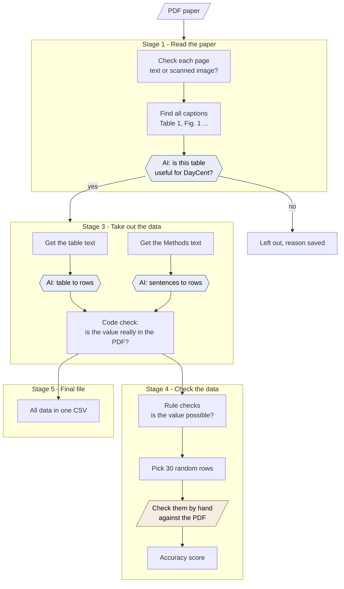
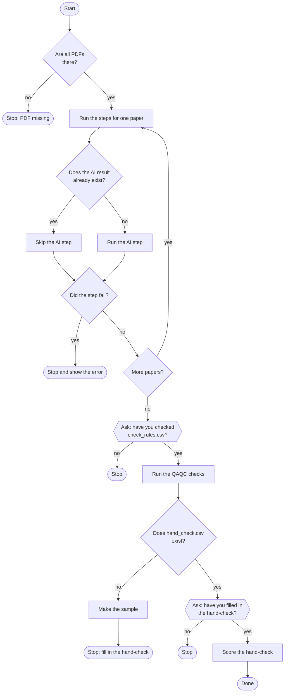
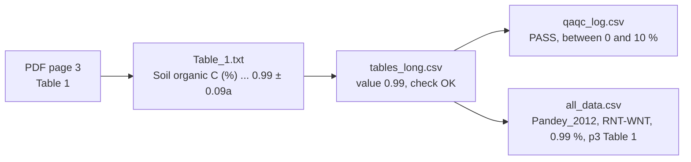
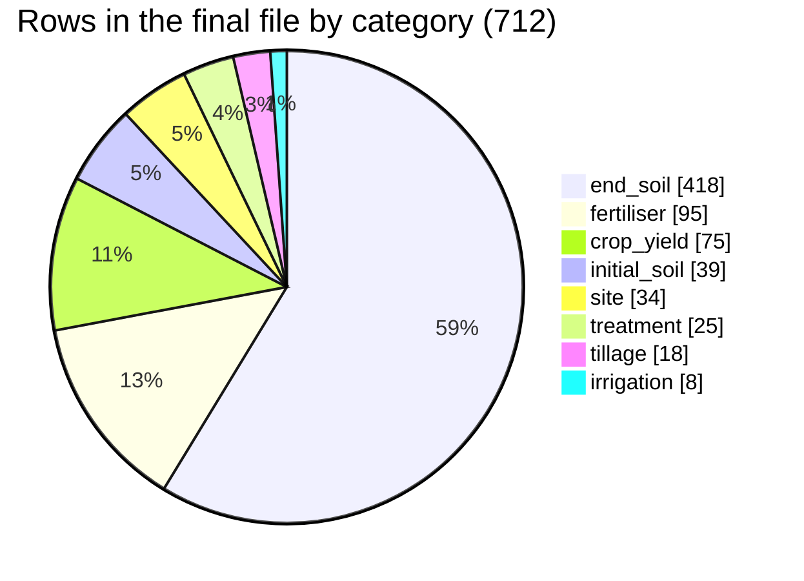
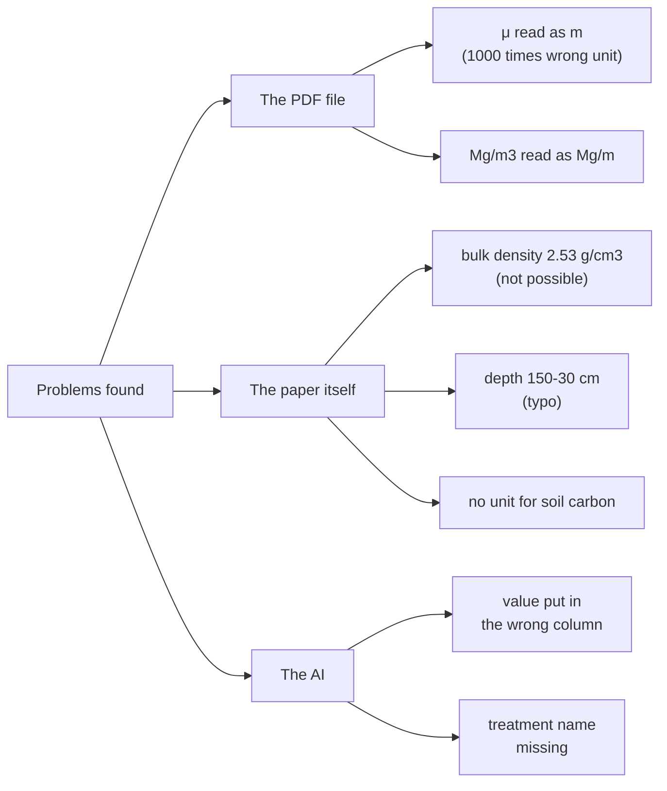

# DayCent Paper Experiment Extraction

This project takes published field-experiment papers (PDF files) and pulls out the data
needed to run the DayCent soil model: site, soil, crops, tillage, fertiliser and irrigation.

I use AI for the parts that need understanding, and plain code for everything else.
Every value in the final data has a page number, so it can be checked in the paper.

I built and tested it on three papers:

| Paper | Pages | Publisher | What the experiment is about |
|---|---|---|---|
| Pandey et al. 2012 | 12 | Elsevier | Tillage in rice and wheat, Varanasi, India |
| Ghosh et al. 2017 | 12 | Springer | Crop rotation and fertiliser, soil carbon, Kanpur, India |
| Sarkar et al. 2011 | 30 | Taylor & Francis | Tillage and crop residue in rice and wheat, Kharagpur, India |

---

## Contents

1. [How the pipeline works](#1-how-the-pipeline-works)
2. [Setup](#2-setup)
3. [How to run it](#3-how-to-run-it)
4. [What it produces](#4-what-it-produces)
5. [Results](#5-results)
6. [Folders](#6-folders)
7. [Why I chose these tools](#7-why-i-chose-these-tools)
8. [Limitations](#8-limitations)

---

## 1. How the pipeline works



Blue boxes use AI. The brown box is done by a person. Stage 2 (reading numbers from
figures) is not done yet, see [Limitations](#8-limitations).

In short:

1. **Stage 1:** I check whether the PDF has real text (all three do, so no OCR is needed).
   Then I find every table and figure caption, and the AI decides which ones have data
   that DayCent needs.
2. **Stage 3:** For the useful tables, code gets the table text row by row, and the AI
   turns it into one row per value. The same is done for the Methods section, where things
   like site location, sowing dates and fertiliser rates are written in sentences.
   After each AI step, code checks that every value really appears in the PDF.
3. **Stage 4:** Code checks whether the values make sense (for example, soil bulk density
   must be between 0.8 and 1.9 g/cm3). Then 30 random rows are checked by hand.
4. **Stage 5:** Everything is joined into one final CSV file.

| Stage | Script | What it does | Output |
|---|---|---|---|
| 1 | `src/stage1_ingest/page_audit.py` | checks if each page is text or a scan | `page_audit.csv` |
| 1 | `src/stage1_ingest/find_captions.py` | finds all table and figure captions | `captions.csv` |
| 1 | `src/stage1_ingest/classify_captions.py` | AI picks the useful tables | `captions_classified.csv`, `captions_input.csv` |
| 3 | `src/stage3_extract/fetch_tables.py` | gets the text of each table, row by row | `tables_text/Table_N.txt` |
| 3 | `src/stage3_extract/tables_to_rows.py` | AI turns each table into rows | `tables_long.csv` |
| 3 | `src/stage3_extract/methods_to_rows.py` | AI turns the Methods text into rows | `methods_text.txt`, `methods_long.csv` |
| 4 | `src/stage4_qaqc/run_qaqc.py` | checks if values are possible | `qaqc_log.csv`, `qaqc_summary.csv` |
| 4 | `src/stage4_qaqc/make_handcheck_sample.py` | picks 30 random rows to check | `qaqc/hand_check.csv` |
| 4 | `src/stage4_qaqc/score_handcheck.py` | counts how many were correct | `handcheck_scores.csv` |
| 5 | `src/stage5_output/build_final.py` | joins everything into one file | `outputs/final/all_data.csv` |

---

## 2. Setup

### 2.1 What you need

| What | Version | Used for |
|---|---|---|
| Python | 3.12 | everything |
| Python packages | listed in `requirements.txt` | reading PDFs, tables, calling the AI |
| Tesseract OCR | 5.5 | only the optional OCR check in stage 1 |
| API key | Goedel Machines | the three AI steps |

### 2.2 Install

```bash
git clone https://github.com/dahiya-04/daycent-paper-experiemnt-extraction.git
cd daycent-paper-experiemnt-extraction

python -m venv .venv312
.venv312\Scripts\activate          # Windows
# source .venv312/bin/activate     # macOS / Linux

pip install -r requirements.txt
```

If you want the OCR check, install Tesseract at `C:\Program Files\Tesseract-OCR\tesseract.exe`.

### 2.3 API key

Make a file called `.env` in the project folder with this line:

```
GOEDEL_API_KEY=your-key-here
```

The `.env` file is in `.gitignore`, so the key is never uploaded. To test that the key works:

```bash
python test_api.py
```

### 2.4 The papers

The PDF files are not in this repository because they are copyrighted. Put them in
`data/raw_pdfs/` with these names:

```
data/raw_pdfs/Pandey_2012.pdf
data/raw_pdfs/Ghosh_2017.pdf
data/raw_pdfs/Sarkar_2011.pdf
```

---

## 3. How to run it

### 3.1 Run everything

```bash
python run_pipeline.py                  # all three papers
python run_pipeline.py Pandey_2012      # only one paper
python run_pipeline.py --rerun-ai       # ask the AI again, even if results already exist
python src/stage5_output/build_final.py # make the final file (after the pipeline)
```

### 3.2 What happens when you run it



Two things to know:

- **The AI is not asked again if its result already exists.** The AI can give a slightly
  different answer each time. If it ran again, the data would no longer match the data I
  already checked. Use `--rerun-ai` only when you really want new AI results.
- **The pipeline stops and asks you at the human steps.** It only goes on if you type `y`.
  It also never overwrites a hand-check that is already filled in.

### 3.3 Run one step at a time

```bash
python src/stage1_ingest/page_audit.py data/raw_pdfs/Pandey_2012.pdf
python src/stage1_ingest/find_captions.py data/raw_pdfs/Pandey_2012.pdf
python src/stage1_ingest/classify_captions.py Pandey_2012
python src/stage3_extract/fetch_tables.py Pandey_2012
python src/stage3_extract/tables_to_rows.py Pandey_2012
python src/stage3_extract/methods_to_rows.py Pandey_2012
python src/stage4_qaqc/run_qaqc.py
python src/stage4_qaqc/make_handcheck_sample.py
python src/stage4_qaqc/score_handcheck.py
python src/stage5_output/build_final.py
```

---

## 4. What it produces

### 4.1 The final file: `outputs/final/all_data.csv`

There is one row for each value. The first eight columns are the format asked for in the task.

| Column | What it means | Example |
|---|---|---|
| `paper_name` | which paper | `Pandey_2012` |
| `Site_name` | where the experiment was done | `... Banaras Hindu University, Varanasi, India` |
| `treatment` | treatment code used in the paper | `RNT-WNT` |
| `crop` | which crop (for Methods rows) | `rice` |
| `depth_cm` | soil layer in cm | `0-15` |
| `variable` | what was measured | `Soil organic C` |
| `value` | the value as printed (only the mean) | `0.99` |
| `unit` | the unit as printed | `%` |
| `Source` | page and table where it comes from | `p3, Table 1` |
| `year` | year of the measurement | `2009` |
| `category` | DayCent input group | `end_soil` |
| `note` | extra information, like what a treatment code means | |
| `from` | came from a `tables` or the `methods` text | |

I never change a value. If a value looks wrong, it is noted in the QAQC log, not changed.

### 4.2 Following one value back to the paper

Every value can be traced back to the PDF, step by step:



### 4.3 Other files

| File | What is in it |
|---|---|
| `outputs/stage1/<paper>/page_audit.csv` | page check results (text or scan) |
| `outputs/stage1/<paper>/captions_classified.csv` | every caption and the AI's decision with a reason |
| `outputs/stage3/<paper>/tables_long.csv` | table rows with the cell the AI copied and the check result |
| `outputs/stage3/<paper>/methods_long.csv` | Methods rows with the sentence the AI used and the check result |
| `outputs/stage4/qaqc_log.csv` | every QAQC check: PASS, WARN, FAIL or INFO, with the reason |
| `outputs/stage4/handcheck_scores.csv` | how accurate the extraction was |
| `docs/` | my notes on decisions and report drafts |

---

## 5. Results

### 5.1 What was extracted

| | Result |
|---|---|
| Pages checked | 54 (all real text, so no OCR needed) |
| Captions found | 40 (16 tables, 24 figures) |
| Tables extracted | 14 |
| Rows in the final file | 712 |



| Category | Pandey 2012 | Ghosh 2017 | Sarkar 2011 |
|---|---:|---:|---:|
| site | 7 | 19 | 8 |
| initial_soil | 9 | 0 | 30 |
| crop_yield | 7 | 5 | 63 |
| tillage | 7 | 0 | 11 |
| fertiliser | 9 | 68 | 18 |
| irrigation | 0 | 6 | 2 |
| end_soil | 39 | 157 | 222 |
| treatment | 8 | 7 | 10 |

A zero means the paper does not give this information, or it is only in a figure.

### 5.2 QAQC checks

| Paper | PASS | WARN | FAIL | INFO |
|---|---:|---:|---:|---:|
| Pandey 2012 | 36 | 1 | 6 | 0 |
| Ghosh 2017 | 47 | 67 | 6 | 21 |
| Sarkar 2011 | 178 | 17 | 4 | 0 |

The problems I found came from three places:



### 5.3 How accurate is it

I picked 30 random rows (5 from tables and 5 from Methods for each paper) and compared
them with the PDFs. The check was done with help from an AI assistant, and I checked
5 of the rows again myself. I agreed with all 5.

| What was checked | Correct | Not needed | Accuracy | 95 % range |
|---|---:|---:|---:|---|
| Value | 30 / 30 | 0 | 100 % | 88.6–100 % |
| Unit | 13 / 13 | 17 | 100 % | 77.2–100 % |
| Depth / year | 17 / 17 | 13 | 100 % | 81.6–100 % |
| Treatment name | 23 / 30 | 0 | 76.7 % | 59.1–88.2 % |
| Whole row | 23 / 30 | 0 | 76.7 % | 59.1–88.2 % |

All the numbers were correct. All the mistakes were in the treatment names.

---

## 6. Folders

```
.
├── run_pipeline.py              runs all steps in order
├── requirements.txt
├── test_api.py                  tests the API key
├── prompts/                     AI prompts (old versions are kept)
│   ├── caption_classifier_v1.txt ... v3.txt
│   ├── table_to_rows_v1.txt
│   └── methods_to_rows_v1.txt, v2.txt
├── qaqc/
│   ├── check_rules.csv          the rules for the QAQC checks
│   └── hand_check.csv           the 30 rows checked by hand
├── src/
│   ├── stage1_ingest/           page check, captions, caption AI
│   ├── stage3_extract/          table text, table AI, Methods AI
│   ├── stage4_qaqc/             QAQC checks and hand-check
│   └── stage5_output/           final file
├── outputs/
│   ├── stage1/<paper>/          page check and caption results
│   ├── stage3/<paper>/          table text and extracted rows
│   ├── stage4/                  QAQC log and hand-check scores
│   └── final/all_data.csv       the final data
├── docs/
│   ├── decisions/               notes on my decisions
│   └── report/                  report drafts
└── data/raw_pdfs/               the PDF papers (not uploaded)
```

---

## 7. Why I chose these tools

The rule I followed:

> If a task has one right answer, code does it. If it needs understanding, the AI does it.
> A person decides what is a believable value.

Before choosing a tool, I tested the options on the same real example from the papers.

| Task | What I used | What I tried and dropped | Why |
|---|---|---|---|
| Read the PDF text | PyMuPDF | pdfplumber, Tesseract OCR | pdfplumber turned "±" into `(cid:6)`; Tesseract read `±2.91` as `42.91` |
| Get tables | group words into rows by their height on the page | pdfplumber, PyMuPDF `find_tables` | `find_tables` lost the decimal point (`0.33` became `033`) |
| Find where a table ends | caption down to the third full-width line | look for a big empty gap | the gap rule cut two tables too early |
| AI model | DeepSeek v4.1 Flash (Goedel Machines) | — | free for students, gives clean JSON answers; it cannot read images |

I changed the prompts when I found a mistake, and I kept the old versions:

| Prompt | What I changed | Why |
|---|---|---|
| Caption classifier v1 to v3 | removed the "validation" option | v1 left out Ghosh's soil carbon tables |
| Methods v1 to v2 | one value per row, add years, list all treatment codes | v1 put several values in one row and missed Sarkar's 10 treatment codes |

More detail is in `docs/report/02_method_draft.md`.

---

## 8. Limitations

| Area | Limitation |
|---|---|
| Figures | Numbers in figures are not extracted, because the AI model cannot read images. Pandey's rice yield is only in Fig. 8. |
| Caption AI | It looks at one caption at a time, and wrongly left out Pandey Fig. 8. |
| PDF symbols | Some symbols like μ, °, ′ and small raised numbers are read wrongly from the PDF. |
| Treatment names | Numbers are reliable, but the AI sometimes loses the treatment name in big tables. |
| Units | Units are kept as printed; they are not converted between papers. |
| Hand-check | Only 30 rows were checked, and it checks if values are correct, not if any were missed. |
| API | The student API keeps the prompts, so it is fine for published papers only. |

The full list with examples is in `docs/report/06_limitations_draft.md`.
